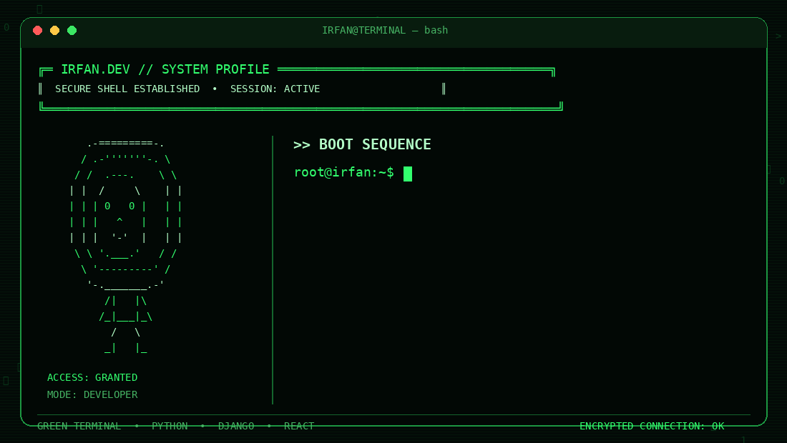

# Hi there 👋

  

## 👨‍💻 About Me

- 💻 Python / Django Backend Developer
- 🚀 Building REST APIs with Django REST Framework
- ⚛️ Learning and building applications with React
- 🗄️ Working with PostgreSQL
- 📍 Kerala, India

## 🛠️ Tech Stack

- **Languages:** Python, JavaScript, HTML, CSS
- **Backend:** Django, Django REST Framework
- **Frontend:** React.js
- **Database:** PostgreSQL, Django ORM
- **Tools:** Git, GitHub, Docker, Postman

## 🚀 Projects

- **DjangoMart** — E-commerce application built with Django REST Framework and React.
- **LicenseGuard** — Offline-first software licensing and device activation system.
- **AI Study Assistant** — Document analysis and question-answering application.
- **Location Sharing App** — Location-sharing application built with React.

## 📫 Contact

- **Email:** irfanmuthu56@gmail.com
- **GitHub:** [IRFAN-DEVo](https://github.com/IRFAN-DEVo)

---

*Thanks for visiting my profile!*
